# Rapport de projet — Prévision de la consommation électrique sur Azure

## 1. Architecture globale 

```text
PJME_hourly.csv (conteneur source)
        ↓
Azure Data Factory — Copy Data
        ↓
Azure Data Lake Storage Gen2 — raw/YYYY/MM/DD/
        ↓
Azure ML Workspace — Datastore → Data Asset
        ↓
Designer — Prétraitement → Feature Engineering
        ↓
Split chronologique → Train Model → Score Model → Evaluate Model
        (exécution sur Compute Cluster)
        ↓
Model Registry — forecasting_model_v1
        ↓
Pipeline d’inférence — Web Service Input → Score Model → Output
```

## 2. Contexte et données

Le projet vise à prévoir la consommation électrique horaire PJME à l’aide d’une régression linéaire. La première phase consiste à explorer les données et expérimenter dans un notebook Python. La deuxième phase reproduit le processus sur Microsoft Azure. Le fichier CSV contient deux colonnes : `Datetime` (horodatage) et `PJME_MW` (puissance consommée en MW). Le rapport initial indique 145 362 lignes ; le nombre exact dépend du stade de nettoyage.

## 3. Stockage et ingestion

Le compte de stockage `ough123` est de type StorageV2, avec performance Standard, réplication LRS et région Europe du Nord. Le projet utilise deux conteneurs, `source` et `raw`. L’organisation cible est `raw/YYYY/MM/DD/`, afin de conserver les données brutes par date d’ingestion.

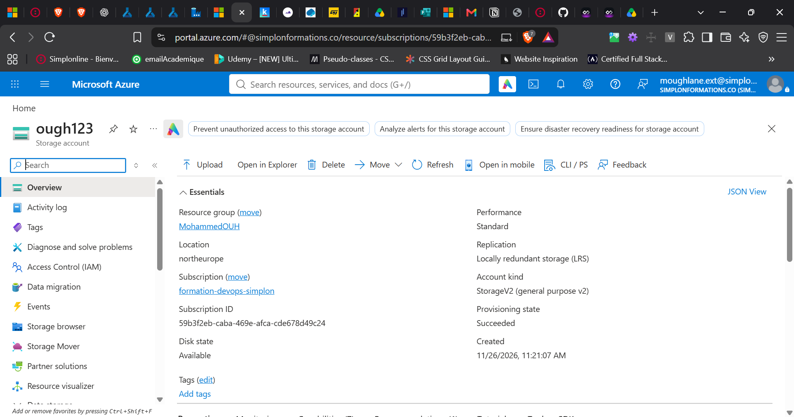

*Figure 1 — Configuration du compte de stockage*

Azure Data Factory permet de connecter les sources et destinations via des Linked Services et des datasets. L’activité `Copy_PJME_To_Raw` copie le CSV vers le conteneur raw. Le chemin horodaté constitue la structure cible du projet ; la capture ne montre pas son expression dynamique.

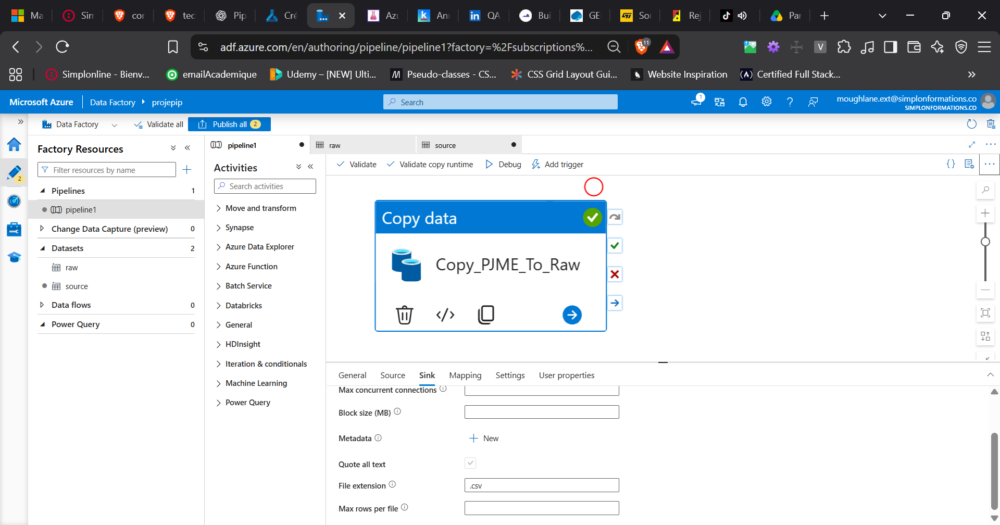

*Figure 2 — Activité Copy Data dans Azure Data Factory*

## 4. Configuration Azure Machine Learning

Le workspace `mlough` centralise les ressources ML. Le datastore fournit un accès au stockage et le Data Asset `datasetoug`, version 1, référence les données utilisées par le Designer. Le cluster de calcul exécute les tâches d’entraînement ; sa taille, son nombre de nœuds et sa région exacte restent à confirmer dans la configuration du cluster.

## 5. Prétraitement et ingénierie des caractéristiques

Le pipeline `PL_PJME_Forecasting_Training` utilise les composants suivants :

- Clean Missing Data : traitement des valeurs manquantes.
- Remove Duplicate Rows : suppression des lignes dupliquées.
- Edit Metadata : conversion de Datetime au type DateTime (format Python `%Y-%m-%d %H:%M:%S` si les secondes sont présentes).
- Summarize Data : statistiques descriptives, sur une branche séparée du flux principal.
- Execute Python Script : regroupement des timestamps dupliqués, tri chronologique, reconstitution des heures manquantes et interpolation temporelle.
- Execute Python Script : création des variables Hour, DayOfWeek, Month, Quarter, Year, DayOfYear, IsWeekend, lag_24, lag_168 et roll_24.

Les lags représentent les consommations passées à 24 et 168 heures. La moyenne mobile utilise les 24 heures précédentes, sans inclure la cible courante.

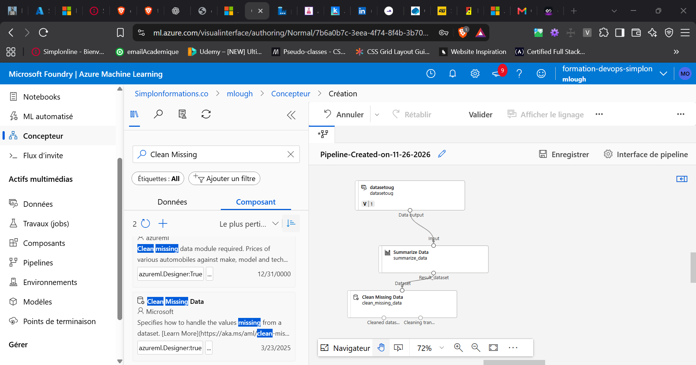

*Figure 3 — Première construction du pipeline (brouillon, branche Summarize Data corrigée ensuite)*

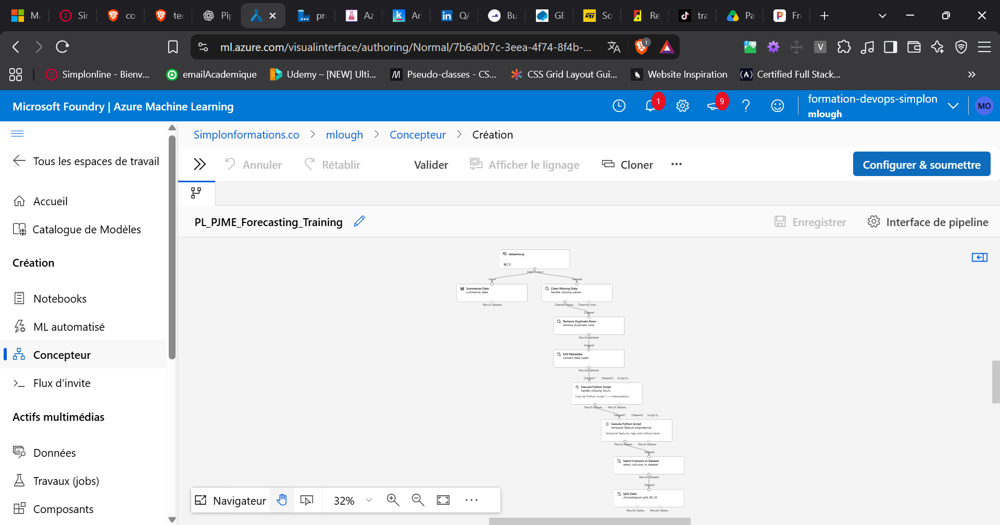

*Figure 4 — Pipeline de prétraitement et feature engineering*

## 6. Séparation chronologique

Le composant Split Data sépare les données en 80 % pour l’entraînement et 20 % pour le test, sans mélange aléatoire prévu. Les composants Select Columns préparent les variables numériques et la cible PJME_MW. La date brute est exclue des entrées du modèle. Les paramètres exacts du split doivent être vérifiés dans le composant.

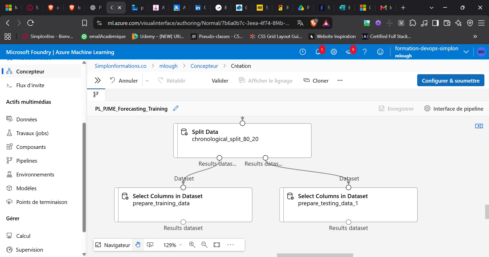

*Figure 5 — Séparation des données train/test*

## 7. Entrainement et prédiction

Linear Regression définit l’algorithme. Train Model apprend les coefficients à partir des données d’entraînement, avec PJME_MW comme cible. Score Model applique le modèle aux données de test. Evaluate Model calcule les métriques de régression.

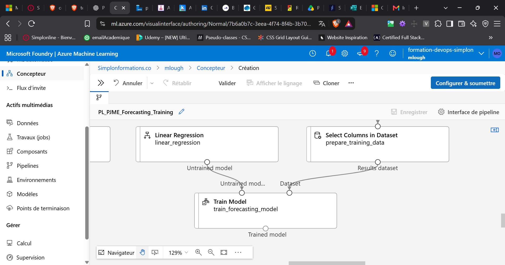

*Figure 6 — Configuration de la régression linéaire*

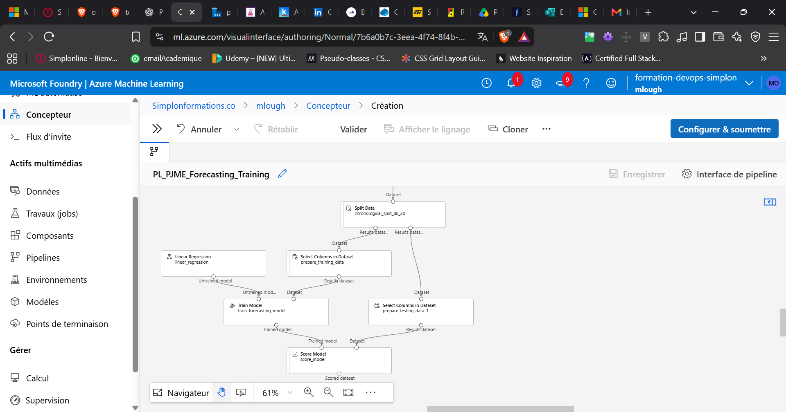

*Figure 7 — Génération des prédictions*

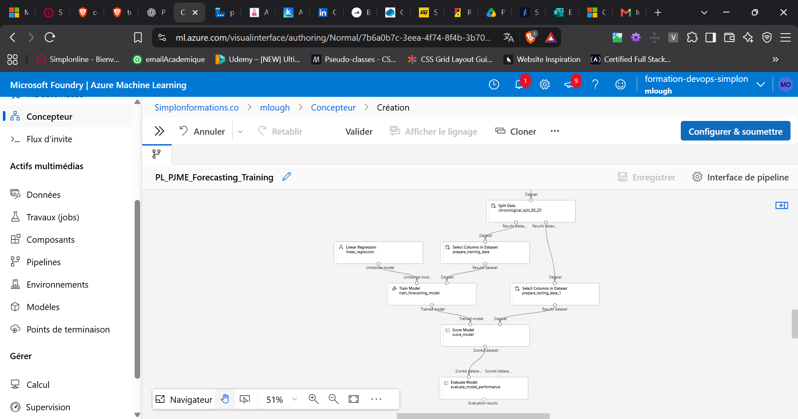

*Figure 8 — Entraînement et évaluation*

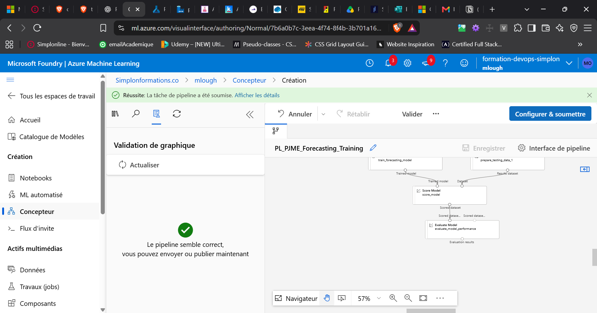

*Figure 9 — Validation et soumission du pipeline*

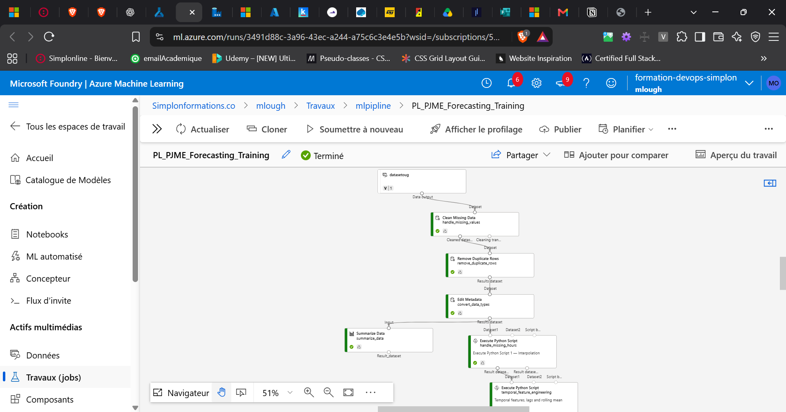

*Figure 10 — Exécution terminée avec succès*

## 8. Résultats obtenus

| Métrique | Valeur | Interprétation |
|---|---:|---|
| R² | 0,8577037 | 85,77 % de la variance expliquée sur les données évaluées |
| MAE | 1 836,662 MW | Erreur absolue moyenne |
| RMSE | 2 448,550 MW | Erreur quadratique moyenne racine, sensible aux grandes erreurs |
| RAE | 0,3642488 | Erreur absolue relative à une référence moyenne |
| RSE | 0,1422963 | Erreur quadratique relative |

Le modèle explique une part importante de la variabilité, mais les erreurs restent significatives. Le R² n’est pas un taux de précision. Le MAPE n’est pas affiché dans cette exécution Azure.

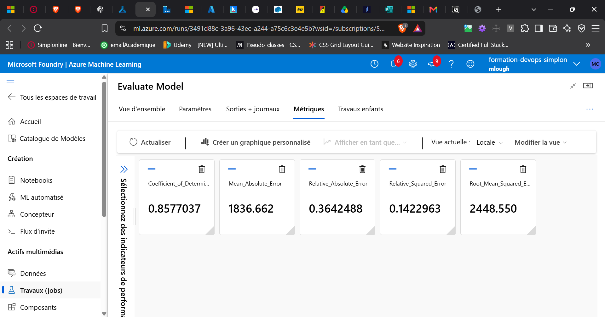

*Figure 11 — Métriques du modèle dans Azure ML*

## 9. Enregistrement du modèle

Le modèle a été enregistré sous `forecasting_model_v1`, version 1, pour permettre sa réutilisation et son versionnement.

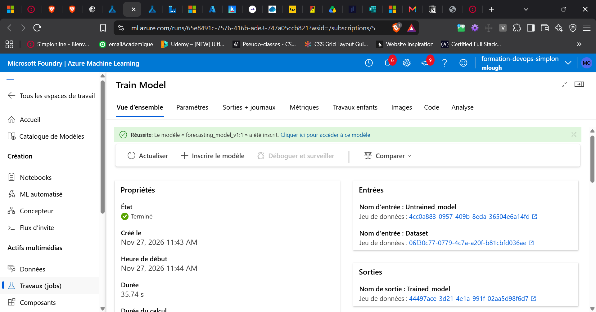

*Figure 12 — Enregistrement réussi du modèle*

## 10. Pipeline d’inférence

Le Designer a généré un pipeline Real-time inference à partir du pipeline d’entraînement. Web Service Input reçoit les données ; Apply Transformation réutilise le nettoyage ; les transformations nécessaires doivent produire les mêmes variables que lors de l’entraînement. Score Model utilise le modèle entraîné et Web Service Output restitue les prédictions.

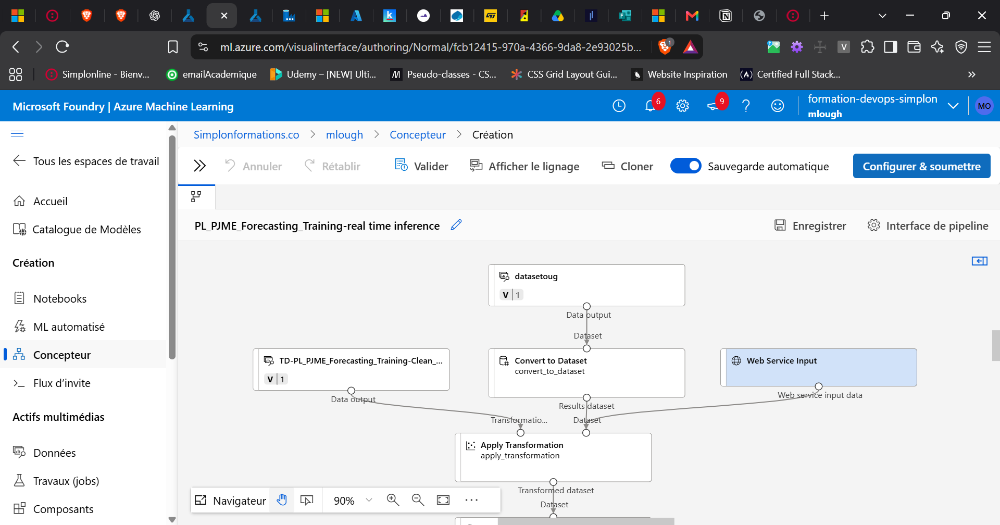

*Figure 13 — Création du pipeline d’inférence en temps réel*

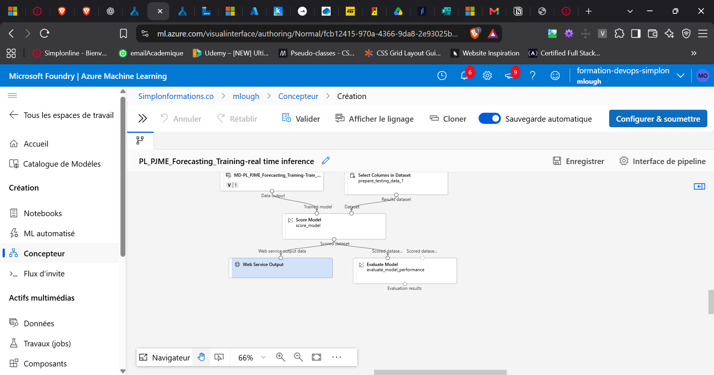

*Figure 14 — Score Model et sortie du service*

Le composant Evaluate Model reste visible dans le brouillon d’inférence et doit être retiré pour une prédiction sans cible connue. Le déploiement et le test d’un endpoint ne sont pas démontrés par les captures.

## 11. Limites, sécurité et ameliorations

- Vérifier que l’interpolation ne transmet pas d’informations futures au jeu d’entraînement et exclure les cibles imputées de l’évaluation réelle.
- Pour une prévision future, fournir l’historique nécessaire aux lags et à la moyenne mobile, ou calculer ces variables en amont. Une date seule ne suffit pas au modèle actuel.
- Comparer les résultats à une baseline temporelle et expérimenter SARIMA ou d’autres modèles.
- Pour la sécurité et le RGPD : limiter les accès via RBAC, éviter de publier les secrets et identifiants de ressources, définir les règles de conservation. Les données décrites sont des mesures agrégées ; la conformité effective reste à vérifier.

## 12. Conclusion

Le projet met en œuvre une chaîne de traitement sur Azure, depuis l’ingestion des données jusqu’a l’entrainement, l’évaluation et l’enregistrement d’un modèle de régression linéaire. L’exécution d’entraînement est terminée et le pipeline d’inférence a été créé. La validation de l’inférence sur des données futures et son déploiement restent les prochaines étapes.
